# Poly Haven: Tools & Equipment models

**52 assets from [Poly Haven](https://polyhaven.com), dedicated to the public domain under [CC0](https://polyhaven.com/license).** Use them in any game, free or paid, and change them however you like; no credit is needed.

3D models as glTF at 1K and 2K texture resolution, each folder self-contained (`.gltf`, `.bin`, `textures/`). 498.9 MB in all.

This is a copy kept by [zuujis-cc0](https://github.com/zuujis-cc0) so game makers can take single files from GitHub. It is not made by or affiliated with Poly Haven: the originals, often in more formats and higher resolutions, are on [polyhaven.com](https://polyhaven.com). If they help you, consider [supporting Poly Haven](https://www.patreon.com/polyhaven/overview).

Every file is listed in [MANIFEST.tsv](MANIFEST.tsv) with its size and SHA-256. More free assets: [the Zuujis collection](https://github.com/zuujis-cc0/free-game-assets#readme).

| | | | |
| :-: | :-: | :-: | :-: |
|  <b><a href="Drill_01">Drill 01</a></b> by Fernando Quinn · <a href="https://polyhaven.com/a/Drill_01">source</a> |  <b><a href="adjustable_wrench">Adjustable Wrench</a></b> by Mateusz Sadek · <a href="https://polyhaven.com/a/adjustable_wrench">source</a> | <a href="bench_vice_01">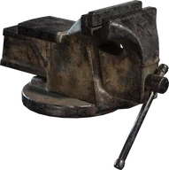</a> <b><a href="bench_vice_01">Bench Vice 01</a></b> by Antanas Kep, Yann Kervran · <a href="https://polyhaven.com/a/bench_vice_01">source</a> | <a href="bolt_cutters_01">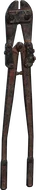</a> <b><a href="bolt_cutters_01">Bolt Cutters 01</a></b> by Antanas Kep, Yann Kervran · <a href="https://polyhaven.com/a/bolt_cutters_01">source</a> |
|  <b><a href="brass_blowtorch">Brass Blowtorch</a></b> by Ulan Cabanilla · <a href="https://polyhaven.com/a/brass_blowtorch">source</a> |  <b><a href="combination_wrench">Combination Wrench</a></b> by BKS · <a href="https://polyhaven.com/a/combination_wrench">source</a> |  <b><a href="cross_pein_hammer">Cross Pein Hammer</a></b> by Tics · <a href="https://polyhaven.com/a/cross_pein_hammer">source</a> |  <b><a href="crowbar_01">Crowbar 01</a></b> by Alexander Otterbeck · <a href="https://polyhaven.com/a/crowbar_01">source</a> |
| <a href="drill_press_01">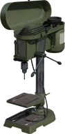</a> <b><a href="drill_press_01">Drill Press 01</a></b> by Viktor · <a href="https://polyhaven.com/a/drill_press_01">source</a> | <a href="dustpan">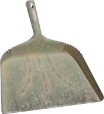</a> <b><a href="dustpan">Dustpan</a></b> by Balen · <a href="https://polyhaven.com/a/dustpan">source</a> |  <b><a href="flathead_screwdriver">Flathead Screwdriver</a></b> by Dylan Detwiller · <a href="https://polyhaven.com/a/flathead_screwdriver">source</a> | <a href="garden_hose_wall_mounted_01">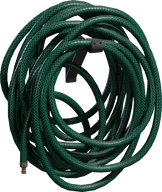</a> <b><a href="garden_hose_wall_mounted_01">Garden Hose Wall Mounted 01</a></b> by Kuutti Siitonen · <a href="https://polyhaven.com/a/garden_hose_wall_mounted_01">source</a> |
| <a href="garden_sprinkler_01">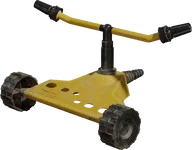</a> <b><a href="garden_sprinkler_01">Garden Sprinkler 01</a></b> by Amal Kumar · <a href="https://polyhaven.com/a/garden_sprinkler_01">source</a> |  <b><a href="hand_plane_no4">Hand Plane No4</a></b> by Satyaki Mandal · <a href="https://polyhaven.com/a/hand_plane_no4">source</a> |  <b><a href="handsaw_wood">Handsaw Wood</a></b> by Konrad Szałankiewicz · <a href="https://polyhaven.com/a/handsaw_wood">source</a> |  <b><a href="hatchet">Hatchet</a></b> by James Ray Cock, Ulan Cabanilla · <a href="https://polyhaven.com/a/hatchet">source</a> |
| <a href="ladder_sectioned_01">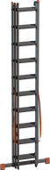</a> <b><a href="ladder_sectioned_01">Ladder Sectioned 01</a></b> by MP · <a href="https://polyhaven.com/a/ladder_sectioned_01">source</a> |  <b><a href="measuring_tape_01">Measuring Tape 01</a></b> by Kuutti Siitonen · <a href="https://polyhaven.com/a/measuring_tape_01">source</a> | <a href="metal_detector">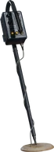</a> <b><a href="metal_detector">Metal Detector</a></b> by Kuutti Siitonen · <a href="https://polyhaven.com/a/metal_detector">source</a> | <a href="metal_tool_chest">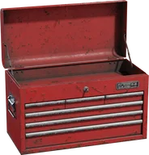</a> <b><a href="metal_tool_chest">Metal Tool Chest</a></b> by John Hutcheson, Yann Kervran · <a href="https://polyhaven.com/a/metal_tool_chest">source</a> |
| <a href="metal_toolbox">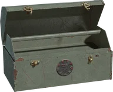</a> <b><a href="metal_toolbox">Metal Toolbox</a></b> by Mateusz Sadek · <a href="https://polyhaven.com/a/metal_toolbox">source</a> | <a href="mousetrap">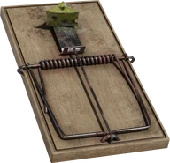</a> <b><a href="mousetrap">Mousetrap</a></b> by GreenPixel · <a href="https://polyhaven.com/a/mousetrap">source</a> | <a href="old_drill_press">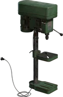</a> <b><a href="old_drill_press">Old Drill Press</a></b> by Harsh Vardhan Singh · <a href="https://polyhaven.com/a/old_drill_press">source</a> |  <b><a href="old_military_compressor">Old Military Compressor</a></b> by Brian Speight · <a href="https://polyhaven.com/a/old_military_compressor">source</a> |
|  <b><a href="picke_dirty_01">Picke Dirty 01</a></b> by Dennis Halbeck · <a href="https://polyhaven.com/a/picke_dirty_01">source</a> | <a href="pipe_wrench">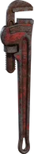</a> <b><a href="pipe_wrench">Pipe Wrench</a></b> by Will Evarts · <a href="https://polyhaven.com/a/pipe_wrench">source</a> |  <b><a href="plastic_broom">Plastic Broom</a></b> by L · <a href="https://polyhaven.com/a/plastic_broom">source</a> |  <b><a href="pliers">Pliers</a></b> by PierreB3D · <a href="https://polyhaven.com/a/pliers">source</a> |
|  <b><a href="plunger">Plunger</a></b> by James Ray Cock · <a href="https://polyhaven.com/a/plunger">source</a> |  <b><a href="portable_welding_cart">Portable Welding Cart</a></b> by Georgii Gorbunov · <a href="https://polyhaven.com/a/portable_welding_cart">source</a> |  <b><a href="propane_torch">Propane Torch</a></b> by Jan W · <a href="https://polyhaven.com/a/propane_torch">source</a> |  <b><a href="propane_torch_02">Propane Torch 02</a></b> by Divine · <a href="https://polyhaven.com/a/propane_torch_02">source</a> |
|  <b><a href="ratchet_wrench">Ratchet Wrench</a></b> by John Hutcheson · <a href="https://polyhaven.com/a/ratchet_wrench">source</a> |  <b><a href="rusted_hacksaw">Rusted Hacksaw</a></b> by Dabou Master · <a href="https://polyhaven.com/a/rusted_hacksaw">source</a> |  <b><a href="rusted_spade_01">Rusted Spade 01</a></b> by Blemonade · <a href="https://polyhaven.com/a/rusted_spade_01">source</a> |  <b><a href="screwdriver">Screwdriver</a></b> by PierreB3D · <a href="https://polyhaven.com/a/screwdriver">source</a> |
| <a href="screwdrivers_02">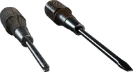</a> <b><a href="screwdrivers_02">Screwdrivers 02</a></b> by BKS · <a href="https://polyhaven.com/a/screwdrivers_02">source</a> |  <b><a href="seeding_tray_01">Seedling Tray 01</a></b> by Satyaki Mandal · <a href="https://polyhaven.com/a/seeding_tray_01">source</a> | <a href="sledgehammer_01">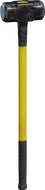</a> <b><a href="sledgehammer_01">Sledgehammer 01</a></b> by Dylan Guzman · <a href="https://polyhaven.com/a/sledgehammer_01">source</a> |  <b><a href="spinning_wheel_01">Spinning Wheel 01</a></b> by Sofia Pahaoja · <a href="https://polyhaven.com/a/spinning_wheel_01">source</a> |
|  <b><a href="tire_pump">Tire Pump</a></b> by Garrison Gager · <a href="https://polyhaven.com/a/tire_pump">source</a> |  <b><a href="tongue_groove_pliers">Tongue & Groove Pliers</a></b> by BKS · <a href="https://polyhaven.com/a/tongue_groove_pliers">source</a> | <a href="trowel_01">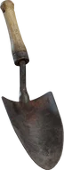</a> <b><a href="trowel_01">Trowel 01</a></b> by Satyaki Mandal · <a href="https://polyhaven.com/a/trowel_01">source</a> |  <b><a href="vintage_hand_drill">Vintage Hand Drill</a></b> by Benjamin McDonnell, Yann Kervran · <a href="https://polyhaven.com/a/vintage_hand_drill">source</a> |
|  <b><a href="watering_can_metal_01">Watering Can Metal 01</a></b> by Charles Nderitu · <a href="https://polyhaven.com/a/watering_can_metal_01">source</a> |  <b><a href="wooden_axe">Wooden Axe</a></b> by Ulan Cabanilla · <a href="https://polyhaven.com/a/wooden_axe">source</a> |  <b><a href="wooden_axe_02">Wooden Axe 02</a></b> by Ulan Cabanilla · <a href="https://polyhaven.com/a/wooden_axe_02">source</a> |  <b><a href="wooden_axe_03">Wooden Axe 03</a></b> by Ulan Cabanilla · <a href="https://polyhaven.com/a/wooden_axe_03">source</a> |
|  <b><a href="wooden_broom">Wooden Broom</a></b> by Balen · <a href="https://polyhaven.com/a/wooden_broom">source</a> |  <b><a href="wooden_hammer_01">Wooden Hammer 01</a></b> by James Ray Cock · <a href="https://polyhaven.com/a/wooden_hammer_01">source</a> |  <b><a href="wooden_ladder">Wooden Ladder</a></b> by Miroslav Turura · <a href="https://polyhaven.com/a/wooden_ladder">source</a> |  <b><a href="wooden_ladder_02">Wooden Ladder 02</a></b> by JN_3DPRINTINGNERD · <a href="https://polyhaven.com/a/wooden_ladder_02">source</a> |

---

Kept up to date by this repository's own [update workflow](.github/workflows/update.yml), with code and plan from [cc0-mirror](https://github.com/zuujis-cc0/cc0-mirror). Something wrong? [Open an issue there](https://github.com/zuujis-cc0/cc0-mirror/issues/new) or use the [private report form](https://games.zuujis.com/report).
